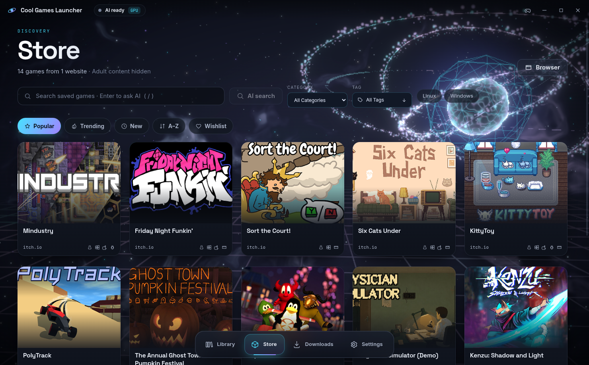

# Cool Games Launcher

A futuristic game launcher for Linux with **local AI** and a bundled inference runtime. Add websites
that host games; while the Store is open, the AI explores them, reads game
names and artwork, and lists what it finds. Download a game; the launcher extracts
portable game archives and adds them to your Library, ready to play natively or
through automatically installed Proton (Wine remains optional).

Everything runs on your computer: one local AI model (Microsoft's **Fara1.5-9B**, a
computer-use model) via llama.cpp on your GPU, a GPU image classifier, and a dedicated
Firefox with uBlock Origin. The model downloads only when requested in Settings and is
stored outside the AppImage. There is no cloud inference, no account and no telemetry.



## What's new in 0.2.11

- **A game in the background**: the 3D scene's centrepiece is now a holographic
  falling-blocks game that plays itself, with neon glass blocks, a landing ghost, the next
  piece, slam trails, and line clears that flash and burst into sparks. It plays faster
  while the AI works or something downloads.
- **Your own sounds**: Settings → Sound → Your own sounds lets any interface sound be an
  MP3 (or OGG, WAV, FLAC, M4A) of yours. At most 5 seconds of a file plays.

## What's new in 0.2.9

- **Several Proton versions**: Settings → Windows games lists every installed Proton
  (GE-Proton, CachyOS, Steam's, folders you add), lets you pick the default and remove
  the ones the launcher installed; each game can use its own version (Launch options).
- **Cover filter**: Settings → Content can hide games with a woman on the cover. A small
  image model (CLIP, downloaded once, 176 MB) checks every cover on your GPU — thousands
  of covers in a few minutes — with a Strict or Balanced setting.
- **Clear download history** in one go (Completed and Failed in Downloads).
- **Quieter while playing**: the AI model and image classifier leave the GPU before a game
  starts, and the 3D scene stops drawing; the ambient soundscape is gone.
- **Funny sounds**: a sound on the close button, with a switch in Settings → Sound.
- **Fixes**: the 3D background no longer flashes on hover and page changes; the AI could
  be shown the previous image when two image questions came in a row.

## What's new in 0.2.7

- **Arabic interface**: Settings → Appearance → Language switches the whole launcher
  (window, AI status, notifications, tray menu) to Arabic, laid out right to left.
- **Updates itself** from this repository's GitHub releases: Settings → About checks for a
  new version, downloads it, verifies it against the release's `SHA256SUMS` and restarts
  into it. Nothing is downloaded until you choose to.
- **Play statistics**: this week's play time per day in the Library, and per game.
- **Gaming comes first**: the AI model leaves the GPU while a game runs; Windows games show
  their ProtonDB rating and get umu's per-game fixes; bundled runtimes (Visual C++,
  DirectX, OpenAL …) install silently before a game's first start; a diagnostics file for
  problem reports (Settings → About).

## What's new in 0.2.0

- **One faster, stronger local AI**: Fara1.5-9B (86.6 % WebVoyager) replaces the three
  swapping 4B models, driven exactly like Microsoft's reference harness (verbatim system
  prompt, screenshot-first turns, normalized 0–1000 coordinates, temperature 0).
- **Fast indexing** with AI-learned site recipes, parallel HTTP reads and a GPU (WebGPU)
  content classifier — about 12× faster per image, and more accurate than the old int8 model.
- **Automation first**: gated pages are skipped and retried, mirrors that want a human
  check are swapped for others, a failed route search retries by itself, paused downloads
  resume the moment a check clears, and Play while Proton is installing starts the game
  automatically when it is ready. The AI never solves CAPTCHAs; when a page truly needs a
  person, only that page waits.
- **New visuals**: plasma core, energy rings, particle data streams, living nebula, hyperspace
  warp between tabs, bloom; holographic tilt cards, kinetic titles, cursor light, and
  synthesized interface sounds (Settings → Appearance).

## Features

| Tab | What it does |
|---|---|
| **Library** | Installed and imported games as floating cover panels, a large Play control, favourites, search, per-game runner (native, Wine, Proton via umu-launcher), launch arguments, executable choice, uninstall. |
| **Store** | Catalog discovered from your websites, search, category/tag dropdowns, platform and website filters, cinematic game detail, Download, and a browser drawer showing the bundled Firefox. |
| **Downloads** | Persistent queue with parallel connections, progress rings, live transfer map, speed/size/ETA, pause/resume/cancel, retries, re-ordering, link re-resolution and automatic extraction into the Library. |
| **Settings** | Websites, content visibility (NSFW), folders, local-AI limits, Valve/GE/CachyOS Proton releases, automatic compatibility installation, Wine/umu paths, appearance (language, low effects, reduced motion), privacy, launcher updates and licences. |

### How discovery works

1. **The AI learns each site once.** On a website's first listing page the local model
   looks at the page's links and decides which are individual games and which lead to
   more listings. Those choices become URL patterns (a *site recipe*), so every further
   page of that site is indexed instantly with no model call. If the layout changes, the
   AI re-learns it.
2. **Pages are read in parallel over plain HTTP**, with your Firefox session's cookies,
   and parsed off the main thread. Pages that need JavaScript or a website check fall
   back to the real Firefox automatically, and the recipe remembers it.
3. **Games appear as soon as their cover passes the content check** (marked *Verifying*),
   while their download routes are verified in the background. News, reviews and
   articles without a game download are removed.
4. **New games are found automatically.** Indexed sites are re-checked every few hours;
   the re-check stops after two listing pages with nothing new, and a full walk runs weekly.
5. Requests are paced per site and slow down by themselves when a site rate-limits (HTTP 429).

Measured on itch.io with an RTX 3070 Laptop: first 10 games visible after ~10 s
(including model start), 100 after ~90 s — itch.io's own rate limit is the ceiling.

Indexing runs **while the Store tab is open**. Downloads do not need the
Store: once you press Download, the AI finds the file, the transfer runs, and
the game is unpacked and added to the Library wherever you are in the app.
The game appears in the Library at once, locked, with its progress, and
unlocks when it is ready to play. AI work runs one task at a time; a
download's decisions come before indexing.

### Downloads

You choose a game in Store and press **Download & add to Library**. Fara chooses the browser actions through external hosts, redirects and release
panels. It observes each result before choosing its next action. There is no
rule-first route or filename-ranking fallback when inference fails.

The agent has screenshot, observed-control click, pointer, typing, scrolling,
waiting, search and page-reading tools. It never answers CAPTCHAs or other human
checks: it waits for checks that clear by themselves, tries another mirror, and only
then asks you; the download resumes on its own once the check is gone. Logins,
required payments and age confirmation are always yours.

After transfer, the AI calls preparation tools and selects an observed playable
executable from the extracted files before registering the game in Library.
Trusted tools perform network transfer, bounded extraction and filesystem
validation. No game or installer runs automatically. ZIP, RAR (including RAR5),
7z and tar archives are supported.

Large HTTP files use up to **8 parallel connections** by default. Change this in
**Settings → Downloads → Connections per file** (1–16), separately from
simultaneous downloads. Compatible hosts must support bounded byte ranges and a
stable validator; other hosts use one connection. Firefox transfers retain their
original requests, cookies, POST bodies and one-use tokens. Speed depends on the
host and your connection. Saved ranges resume after pauses and restarts.


### Popular, Trending and descriptions

The Store opens on **Popular**, with **Trending**, **New** and **A–Z** beside
it. Popularity comes from the websites themselves: their own "Popular" /
"Most downloaded" and "Trending" pages (found in their menus) or such blocks on
their front page, read on every re-check, plus download, view and rating
counts a game page publishes. A site that publishes none of these sorts newest
first, and the Store says so. Your filters, sort and scroll position are kept
while you visit other tabs (and the filters across restarts).

Many download sites put the same advertising sentence in every page's
description. The launcher reads the game's own "About" / "Overview" text
instead, and when a page has none it uses the short description from the
game's public Steam store page (shown as such). Older catalog entries are
repaired in the background, games you open first. Tags are filtered for noise
and searchable.

### Split downloads, disk space and damaged files

Games published in several files (`game.part1.rar` …, `game.7z.001` …,
`game.r00` …, or separately packed `Game-Part1.zip` …) are downloaded part by
part: direct links next to the first part are taken as they are, otherwise the
AI fetches "part N" from the game page; when the page does not say how many
parts there are, the launcher looks for the next one until there is none. The
Library shows one entry with the combined progress; Downloads lists each part.
Once every part has arrived the game is unpacked once.

After a game is installed its downloaded files are no longer needed. The
Library offers to delete them (or does it automatically: **Settings → Downloads
& updates → After a game is installed**). A download that turns out to be
damaged when unpacking is fetched again once by itself.

### Playing: launch options, saves, shortcuts, couch mode

Each game's **Launch options** in the Library hold its Proton version,
Gamescope (true fullscreen, resolution, FSR/NIS upscaling), a frame-rate cap
(through Gamescope, or DXVK/VKD3D without it), MangoHud, GameMode, NVIDIA
DLSS/Reflex (NVAPI), the WineD3D compatibility renderer and extra environment
variables. Gamescope, MangoHud and GameMode are used when installed on the
system.

Saves are backed up after every play session of a minute or more and before
updates, rollbacks and uninstalls: the user folders of the game's Proton prefix
(AppData, Documents, Saved Games — caches skipped) and the files the game wrote
in its own folder. The last five backups are kept as plain folders and can be
restored with one click (the current state is backed up first).

Games can be added to the applications menu or the desktop; the shortcut starts
the game through the launcher. Closing the window keeps the launcher in the
system tray (downloads and preparation continue); the tray starts recent games.

**Couch mode** (the controller button in the title bar, or Start/Menu on a
controller) is a full-screen view for the TV: rows of big artwork for the games
you play, games on the way, Trending, Popular and your wishlist, driven by
D-pad/stick (A play/open, Y wishlist, B back) or the keyboard. Outside couch
mode a controller moves focus through the normal interface.

The Library shows how long you played on each day of the last week, the most
played game, and each game's time this week.

### Steam store data, wishlist and search

For games that are on Steam, the launcher reads Steam's public store data
(batched): artwork (wide banner, logo, capsule), review score, release date,
description, screenshots and trailers (played with hls.js). Only all-ages media
is used, and only for games that passed the content check. The **Wishlist**
watches games for a new version and titles that are not on your websites yet;
both arrive as desktop notifications that open the game. Game pages list
**Similar games** (shared genres and tags), and search tolerates typos
("witcer 3" finds The Witcher 3; numbers must match).

### Game updates

Installed games are checked for new versions in the background, on the same
schedule as indexing (Settings → Websites & indexing), even when the Store is
closed. The launcher reads the game's page and compares what it offers with
what you installed: the version or build number in the title, a labelled
"Version:" line, the download file names and sizes, the page's modification
date, and the downloaded file's own ETag/size on the server. A new build posted
as a separate page ("Game v1.3") is recognised as an update of the game you have.

The Library then shows **Update available (v1.2 → v1.3)**, or installs it by
itself if you choose **Settings → Downloads & updates → Update automatically**.
The new version unpacks into its own folder while the old one stays playable.
Files the game created or changed in its folder (saves, settings) are copied
across; the Proton prefix, where most Windows games keep saves, is shared by
both versions. The previous version is kept until you have played the new one
for a minute, and **Roll back** returns to it with your newer saves.

### Adult content

**Show NSFW games** is off by default. Turning it on shows an 18+ warning;
Cancel leaves it off. Consent is stored locally and survives restarts; turning
the setting off revokes it, so turning it on again asks again. Classification
runs in both modes; the setting only changes visibility, and unclassified games
stay hidden either way. See [docs/CLASSIFIER.md](docs/CLASSIFIER.md) for measured
accuracy and limitations.

## Requirements

- Linux x86_64 with glibc 2.34 or newer and desktop GTK/NSS/graphics libraries (Ubuntu 22.04+, Debian 12+, current Fedora). Alpine/musl and ARM are unsupported.
- RAM depends on the selected model: 8 GB or more for 2B/4B, 16 GB for 8B, and 32 GB for 32B are recommended starting points. More RAM helps when running other apps. Actual usage depends on context, images and acceleration.
- Optional: a Vulkan-capable GPU (used automatically; falls back to CPU).
- For Windows games: Python 3. Proton is selected from installed builds or provisioned automatically into the Downloads queue, verified with SHA-256, then extracted. The bundled umu-launcher downloads the Steam Linux Runtime on first use. Wine remains optional.
- Settings → Compatibility offers official Valve release information, GE-Proton and CachyOS Proton. Lists refresh at startup and every 15 minutes while the app runs, with manual Refresh and an offline cache. Valve binaries are installed through Steam and then selected from detected installations; compatible community archives install directly.

### Local AI

Settings → Local AI downloads **Fara1.5-9B** (Q4_K_M + vision projector, 6.8 GB, SHA-256
pinned). One model serves every role — browsing, page analysis, and choosing a game's
executable — so it stays loaded on the GPU instead of reloading between tasks. On an
8 GB GPU all 33 layers fit; first use compiles GPU shaders once, and the model warms up
whenever the Store opens. The older Fara4B/Holo/Qwen team is still selectable; installs
that used it switch to Fara1.5-9B automatically once it is verified.

Fara is driven exactly like Microsoft's reference harness (github.com/microsoft/fara):
the verbatim system prompt and tool definition, screenshot-first observation turns,
the last three screenshots in context, normalized 0–1000 coordinates and temperature 0.
Extraction-style questions (site learning, page checks) run with thinking disabled.

No language model weights or vision projectors ship in the AppImage. The fp16 ONNX
content classifier (run on the GPU through WebGPU, CPU fallback) and the inference
runtime remain bundled.

## Run

Download the AppImage and `SHA256SUMS` from the
[latest release](https://github.com/Elias966/cool-games-launcher/releases/latest), then:

```bash
sha256sum -c SHA256SUMS
```

```bash
chmod +x Cool-Games-Launcher-0.2.11-x86_64.AppImage
```

```bash
./Cool-Games-Launcher-0.2.11-x86_64.AppImage
```

The launcher updates itself from the same releases (Settings → About → Launcher
updates): it downloads the new AppImage next to the running one, checks it
against `SHA256SUMS` and replaces the file before restarting, so keep the
AppImage in a folder you can write to. A newer AppImage can also be installed
from a file there.

The static AppImage runtime does not require FUSE 2. If mounting is unavailable, run it with `--appimage-extract-and-run`. On
systems that restrict unprivileged user namespaces (Ubuntu 24.04+), the
launcher starts Electron without Chromium's sandbox and says so on stderr; web
content never runs in Electron — it stays in the bundled Firefox.

User data follows the XDG base-directory spec:
`~/.local/share/cool-games-launcher` (database, games, prefixes, logs, browser
profile), `~/.cache/cool-games-launcher` (artwork), `~/.config/cool-games-launcher`.

## Build from source

See [docs/BUILDING.md](docs/BUILDING.md). In short:

```bash
npm ci && npm run vendor && npm run dist
```

## Documentation

- [docs/ARCHITECTURE.md](docs/ARCHITECTURE.md) — processes, IPC, security model, data flow
- [docs/BUILDING.md](docs/BUILDING.md) — building, development loop, packaging, checksums
- [docs/CLASSIFIER.md](docs/CLASSIFIER.md) — content classification and measured limitations
- [docs/TESTING.md](docs/TESTING.md) — automated tests and acceptance-test status
- [THIRD_PARTY_NOTICES.md](THIRD_PARTY_NOTICES.md) — bundled components and licences

## Responsible use

Only download games you are allowed to download, and respect each website's
terms. The launcher does not bypass DRM, purchases or login requirements, does
not use torrents, and only updates games from the page you installed them from. Website support is
best effort; some sites block automated browsing, and the launcher shows that
as a blocked or unsupported state rather than working around it.

## Licence

Copyright © 2026 Cool Games Launcher contributors.

This program is free software: you can redistribute it and/or modify it under
the terms of the GNU General Public License as published by the Free Software
Foundation, either version 3 of the License, or (at your option) any later
version. It is distributed in the hope that it will be useful, but **WITHOUT ANY
WARRANTY**; without even the implied warranty of MERCHANTABILITY or FITNESS FOR
A PARTICULAR PURPOSE, to the extent permitted by applicable law. See
[LICENSE](LICENSE). Bundled components keep their own licences; see
[THIRD_PARTY_NOTICES.md](THIRD_PARTY_NOTICES.md).

## Store verification recovery (0.1.4)

Complete website checks in the Store browser or full Firefox, then return to the launcher. Discovery resumes from its checkpoint automatically. Pages per batch controls indexing batches; pending pages and categories continue while Store remains open. Download follows the selected game through supported external hosts and prepares portable archives into Library. The local vision agent can attempt visible checks; refused automation and unsolved challenges remain interactive.

## Saved Store indexing (0.1.6)

Verified games, artwork, categories, tags and download routes stay in the local
SQLite catalog during rescans. A rescan continues an unfinished queue first;
a completed scan can look for new games without rechecking known details.
Closing the launcher preserves the current listing viewport, discovered routes
and in-flight game. Site errors retain that checkpoint, with bounded automatic
retries; Retry resumes it. Search reads saved verified entries while AI works.
The upgrade also restores stored download evidence hidden by the old Rescan.
